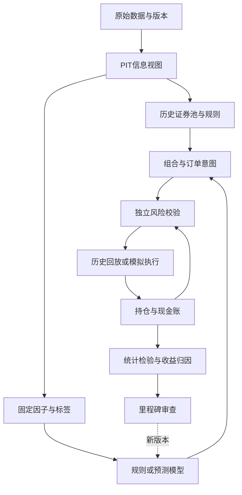

# 中国 A 股系统化量化投资研究报告

## 第一阶段 从收益来源证据到可执行研究规范

研究截止：2026-11-14，Asia/Shanghai。版本 phase1-v0.1。

**第一阶段结论：优先建设可以否定策略的研究系统，第一批检验四个方向——ETF轮动与趋势基线、低换手价值与盈利质量、短期残差反转、具备真实发布时间的盈利事件。现有证据不支持预先认定轮动、量价或复杂AI为最优解。**

本期已完成公开文献、市场规则、数据供应商与统计方法研究，并形成九份工程交接初稿及证据附录。没有取得投资账户、购买数据、运行本项目回测或创建远程仓库；文中不提供虚构的预期收益、Sharpe或回撤。本文所有策略参数均为研究初值。

## A Executive Summary

### A1 A股收益来源应分成不同的问题

可以配置的长期风险溢价、基准之外的预测能力、风险治理价值以及执行节约，是四类不同成果。市场上涨时持有权益能带来正回报；价值/规模/盈利等风格也可能形成长期收益差异，但它们可能伴随经济风险、流动性风险和长期低迷。某组合跑赢沪深300，并不自动说明有独立Alpha。

本项目先检验：同池被动配置能获得什么；策略额外改变了哪些行业/风格/仓位；这些变化在成本后是否改善风险调整收益；增加复杂模块是否还有增量。没有账户和回测前，不能回答“你的收益有多少百分比来自行业轮动”这样的精确归因。

纯A股现货做多加现金可以减少部分下跌暴露，但不能从逻辑上推出稳定绝对收益。空仓既可能躲过下跌，也可能错过快速反弹。项目若最终只发现透明、成本低的风格配置，而没有独立选股Alpha，应如实接受该结论。

### A2 三项足以改变研究排序的原始证据

1. **复制失败率高。** Li等发表于Management Science的研究（线上2023-12-07，卷期2024-08，样本2000—2019）复现469个A股异象，采用主板分位点和市值加权后，83.37%的原始高减低五分位价差未达显著。其结果说明微盘赋权和检验设计会改变发现数量；不能据此把剩余变量视为当前可交易策略，也不能把不显著解释为效应严格为零。[原始机构页](https://research.polyu.edu.hk/en/publications/replicating-and-digesting-anomalies-in-the-chinese-a-share-market/)；[作者全文](https://ira.lib.polyu.edu.hk/bitstream/10397/115240/1/Li_Replicating_Digesting_Anomalies.pdf)。
2. **A股因子定义与欧美并不等同。** Liu、Stambaugh、Yuan（JFE，2019，样本2000—2016）以E/P构造价值因子，并排除最小30%公司以减弱当时壳价值影响；部分盈利、波动异象会被中国特化的规模/价值模型解释。这个设计揭示的是历史制度依赖，不是永久的30%选股秘诀。[作者全文](https://rodneywhitecenter.wharton.upenn.edu/wp-content/uploads/2019/04/01-18-Stambaugh.Published.BlumePrize.pdf)。
3. **质量和普通动量不能预设有效。** Jansen、Swinkels、Zhou（2021，样本2000—2019）比较32类异象，价值、风险、交易类证据较强，质量、规模和一般过去收益类较弱，残差动量与反转为例外。其主要统计表及盈亏平衡成本分析不等同于逐单可成交的个人账户净收益。[原文](https://pure.eur.nl/ws/portalfiles/portal/58642799/Anomalies_in_the_China_A_share_market.pdf)。

以上为Verified Evidence：核实论文内容及其范围。本项目能否实现对应效果全部仍为Research Hypothesis。

### A3 推荐排序

R1先行是因为ETF价格、产品历史和成本结构较易审计，可建立所有后续研究的反事实基线。R2的低换手基本面信号有文献基础，但质量必须证明增量。R3有行为机制且容易被费用证伪，适合快速决定是否值得深入。R4有原始事件文献，但数据门槛更高，须区分正式报告、预告、快报和分析师版本。

机器学习作为上述策略的表示/组合工具，而非独立经济收益来源。Leippold等（JFE，2022，数据2000-01至2020-06）提供中国市场机器学习及成本敏感性的原始研究，但其样本外表现不能直接当作2026年的证据。相同数据与预算下，树模型不超过线性模型就删除它。[作者机构全文](https://zibs.zju.edu.cn/_upload/article/files/21/78/16f84f524d7daebc5d2831d43ec9/d107b0a1-790d-4d4d-b87b-e168849235ca.pdf)。

## B A股市场结构与 Alpha Landscape

### B1 三个集合与板块作用

| 集合 | 定义 | 当前项目处理 |
|---|---|---|
| Research Universe | 全A、指数、ETF及外生市场 | 保留科创板和北交所信息；用于市场广度、板块与行业状态 |
| Tradable Universe | 账户权限与当时证券状态共同允许 | 主板；创业板待账户核验；科创板个股禁止；北交所默认不交易 |
| Proxy Universe | 当时存在、满足资格的替代工具 | 科创等相关ETF可独立核验；产品成本、跟踪、折溢价与流动性单独评估 |

板块本身不是纯粹风格因子。创业板/科创板的相对表现可能同时反映行业、规模、盈利阶段和估值暴露。要检验板块领先关系，应先控制行业/规模/成长暴露，并按真实信息可用时点比较；不能把科技行业上涨全部解释为“科创板领先主板”。北交所另外面对较短可比历史、不同微观规则与流动性，需要单独样本和解释。

### B2 当前规则与历史断点

下表是关键摘要，完整日期和原始链接见 [市场规则附录](evidence/MARKET_RULES.md)，不是可直接替代逐证券规则表的完整法条。

| 对象/事项 | 当前研究须识别的规则 | 重要历史边界 |
|---|---|---|
| 沪深主板普通股 | 通常10%日涨跌幅，买入100股整数倍 | 注册制新股前5日无日涨跌幅不能套回旧IPO |
| 主板ST/*ST | 2026-07-06起10% | 此前通常5%；沪深2026-04-24发布新规 |
| 创业板 | 通常20%，新股前5日例外 | 2020-08-24由旧制切换，存在退市过渡例外 |
| 科创板 | 通常20%，新股前5日例外；200股起 | 用户无个股权限，研究和代理工具分开 |
| 北交所 | 通常30%，新发行首日等例外；100股起可逐股增加 | 2026规则部分盘后条款暂缓，不能照搬沪深 |
| 股票与境内股票ETF | 通常T+1；ETF不能一概认为T+0 | 跨境/债券/货币/黄金等例外按产品核验 |
| 沪深盘后固定价格 | 2026-07-06后扩至A股和ETF | 存在收盘价撮合不等于日线回测可无条件收盘成交 |

来源：[上交所修订说明，2026-04-24](https://star.sse.com.cn/aboutus/mediacenter/hotandd/c/c_20260424_10816474.shtml)、[深交所2026规则原文](https://docs.static.szse.cn/www/lawrules/rule/trade/current/W020260424690713155663.pdf)、[北交所2026规则通知](https://www.bse.cn/jygl_list/200028217.html)。北交所页面直接读取存在重定向问题，正文可由官方检索结果核查，正式采用前仍须归档原件。

本项目MVP统一21:00信息截止、下一交易日执行。未来研究15:05—15:30盘后交易时，须另证信息到达、委托时刻、队列和成交量，尤其不能拿15:30才完整的当日成交量预测15:05成交。

### B3 时间尺度改变了收益机制和可捕获性

| 尺度 | 候选机制 | 主要障碍 | 项目态度 |
|---|---|---|---|
| 盘中/隔夜 | 订单流、价差、信息到达、临时冲击 | 数据/队列/延时、T+1、最低收费 | 初期不争速度优势 |
| 数日—数周 | 反转、事件漂移、注意力、拥挤 | 坏消息延续、涨跌停、换手 | 有限且明确的可证伪实验 |
| 数周—数月 | 行业/板块相对强弱、盈利修正 | 风格共线、周期少、分类变更 | ETF与低频股票优先 |
| 数季—数年 | 市场/价值/盈利/风险溢价 | 长期低迷、估值与制度变化 | 适合作战略配置研究，不保证任意时期获利 |

这些是机制假设和研究设计，而不是对每个时段Alpha占比的实证结论。微盘收益、非流动性溢价、承担崩盘风险的反转等，均可能是风险补偿。涨得多不自动表示更有效率的策略。

### B4 四类轮动必须各自检验

| 类型 | 应预测什么 | 必要对照 | 最容易产生的错觉 |
|---|---|---|---|
| 市场板块 | 板块下一持有期相对风险调整收益 | 固定板块混合、行业/规模匹配 | 把科技/小盘暴露当板块预测能力 |
| 行业 | 行业相对收益和可交易ETF回报 | 同期同池行业等权；行业内选股独立 | 用当代行业分类和回溯指数重构历史 |
| 主题/产业链 | 新信息、扩散和拥挤对未来收益的增量 | 当时词典/成员、行业及动量控制 | 事后命名、新闻解释代替事前预测 |
| 风格 | 风格溢价变化是否可被提前预测 | 静态风格混合与同风险组合 | 风格长期有溢价被误读为会择时 |

行业动量研究有可核查原始论文，例如Boubaker等（线上2021-12-02，样本2007-06至2020-12），但本轮仅取得摘要，未核实其历史分类、参数选择和费用后执行。这足以支持提出假设，不足以授予策略“已证实”评级。[期刊原始页面](https://link.springer.com/article/10.1057/s41260-021-00248-8)。

主题研究可从四组当时可见指标定义状态：报道/公告出现率和新参与公司数衡量形成；成员上涨广度、产业链分层扩散衡量扩散；换手/成交份额集中、短期价格加速与估值分化衡量拥挤；广度下滑、龙头滞涨和成交分化衡量衰退。这些只是可操作定义候选，阈值须前注册，不能因事后行情给状态命名。AI、机器人、半导体等只作样本主题；产业前景不直接构成买入理由。

领先滞后要测试“t时点信息是否改善t+1之后预测”，控制同期共同冲击、非同步交易、节假日、行业重叠并做多重检验。即使一个行业经常先涨，也可能只是其他行业暴露更低或交易时钟不同。

### B5 宏观资金与市场状态

优先检验少量可审计内部信息：趋势、实现波动、广度、成交额变化、行业离散度和成交集中度。宏观政策变量后置，因为发布滞后、修订和市场预期会改变解释。CPI/PPI/PMI/信用数据的好坏与股票下一期回报没有固定单调关系；应研究相对当时预期的新信息，而非把“政策支持”编码为永恒利好。

资金字段也要拆清：成交额、主动买卖推断、ETF份额净增和季报持仓并不是同一个量。ETF规模增加可能来自价格上涨；基金份额变化可能包含实物申赎，不能直接等同外部现金入市。

北向公开数据还存在实质制度断点：港交所2024-07-26通告规定，2024-08-19起有关持仓信息改为季度后第五个北向交易日披露。旧逐日持仓/净流入策略不得把供应商估算值无缝当作相同官方信息延续。[港交所原始通告](https://www.hkex.com.hk/-/media/HKEX-Market/Services/Circulars-and-Notices/Participant-and-Members-Circulars/HKSCC/2024/ce_HKSCC_NOM_217_2024.pdf)。

状态模型比较顺序为：不择时→简单200日趋势→有限的两状态模型。HMM只能使用过滤概率P(s_t|X_≤t)，不能用读完整历史后的平滑状态。市场每天有几千只股票，不会让宏观独立周期也变成几千个。

### B6 个人投资者的优势和劣势

小资金可以回避机构基准约束，降低部分容量压力、等待机会和持有现金；这些是灵活性，不是Alpha证明。弱点是数据固定费用、最低佣金、整手造成的分散不足，以及缺少交易基础设施和研究治理。工程能力应主要用于数据审计、复现和快速证伪，不能通过增加模型参数补足独立市场周期。

按每笔最低5元的保守情景，一笔1,000元买入再卖出仅佣金即10元，约1%；5,000元往返最低佣金约0.2%，10,000元约0.1%。还未加股票卖出印花税、过户费和滑点。最低收费有官方依据，实际产品和账户费用须合法费表核验。[上交所当前费用指引](https://one.sse.com.cn/onething/gptz/)；[2002年原始通知](https://www.chinatax.gov.cn/n810341/n810765/n812203/n813164/c1209808/content.html)。

因此1万元应先评估低换手ETF；10万元先比较ETF与少量可分散股票的成本；50万和100万元再认真比较约30只股票组合与ETF。资金增多不自动开启科创板权限，也不保证买卖微盘时能退出。

## C Strategy Research Matrix

下面两张表共同构成20类候选比较；文献编号L01—L11对应[文献证据登记](evidence/ALPHA_LITERATURE.md)。成本、容量和复杂度是工程预判，未经过本项目成交数据校准。候选时间尺度不代表授权穷举所有窗口。

### C1 机制与证据

“环境”是需要分层检验的机制假设，不是可事先准确识别的市场标签。不得据事后牛熊分类训练实时策略。

| ID／类别 | 理论机制或主要收益来源 | 已有证据与项目分类 | 候选预测／交易尺度 | 应重点检查的环境 |
|---|---|---|---|---|
| H01 价值 | 买入相对盈利／现金流便宜的资产，可能包含风险补偿与错误定价修复 | L01/L02 有历史证据；可执行净收益为 **Research Hypothesis** | 月—年，低频再平衡 | 估值分化、盈利恶化、周期盈利高点 |
| H02 盈利与质量 | 盈利持续性、现金转化及资产负债稳健可能改善选择或尾部 | L01/L02 对独立贡献结论有限；**Research Hypothesis**，不预设质量 Alpha | 月—年 | 财务压力、行业会计差异、估值过高 |
| H03 高股息 | 现金分配与估值暴露，可能兼具行业和利率敏感性 | L02 覆盖股息率；净税后效果为 **Research Hypothesis** | 季—年 | 利率变化、股息削减、金融／公用事业集中 |
| H04 小盘与微盘 | 规模风险、流动性补偿、历史壳价值及投机偏好 | L01/L03 显示制度与权重敏感；**Research Hypothesis**，微盘延后 | 周—季 | 流动性收缩、退市风险、拥挤平仓 |
| H05 低波与低 Beta | 降低风险暴露；异常收益可能来自杠杆限制、偏好或风格重叠 | L01/L02 有历史研究；独立 Alpha 为 **Research Hypothesis** | 月—季 | 下跌、反弹、持续上涨中的机会成本 |
| H06 低换手与异常换手 | 关注度／投机定价、流动性与交易需求变化 | L01/L02/L04 有研究支撑；方向与可交易性为 **Research Hypothesis** | 周—月 | 成交过热、流动性枯竭、换手结构变化 |
| H07 普通个股中期动量 | 信息反应迟缓或价格延续 | L01/L02 不支持照搬欧美结论；**Research Hypothesis**，低优先级 | 月—季 | 趋势与急速反转，不能按事后环境择优 |
| H08 残差动量 | 剥离共同风险后考察个股信息的延续 | L02 有历史支持；**Research Hypothesis** | 月—季 | 风格突变、残差模型漂移 |
| H09 短期残差反转 | 临时价格压力、流动性提供及过度反应 | L01/L02 提供历史支持且费用敏感；**Research Hypothesis** | 数日—数周 | 下跌接飞刀、跌停连续性、反弹成交困难 |
| H10 多尺度量价趋势 | 价格和成交量携带不同期限的预测信息 | L09 为专门因子研究；不是普通均线择时；**Research Hypothesis** | 周—月 | 高参与交易期与结构改变 |
| H11 行业相对动量 | 行业信息扩散、景气延续与投资者调整迟缓 | L05 仅摘要级支持，成本与 PIT 分类待核；**Research Hypothesis** | 月—季 | 行业分化、相关性上升、热点急转 |
| H12 市场板块轮动 | 不同上市板块的产业／规模／估值暴露变化 | 未核实足够直接可复制预测证据；**Research Hypothesis** | 周—季 | 成长偏好、流动性变化、板块规则变化 |
| H13 风格轮动 | 风险价格或拥挤状态变化导致风格相对收益变化 | 静态风格溢价不证明择时；**Research Hypothesis** | 月—季 | 风格拥挤、长期落后后反转 |
| H14 指数趋势与波动管理 | 动态降低下行暴露，可能改善风险效用但牺牲反弹 | 本项目的必要风控基线；**Research Hypothesis**，不是预设 Alpha | 周—月决策 | 持续下行、震荡反复、跳空和 V 形反弹 |
| H15 盈利公告后漂移 | 盈利惊喜逐步被吸收 | L06/L07 有中国文献；费用后纯做多为 **Research Hypothesis** | 公告后数日—数月 | 首次信息披露、关注度与预期分歧 |
| H16 分析师预期修正 | 新的基本面信息与市场吸收速度差异 | L08 支持信息含量，样本／费用仍有访问缺口；**Research Hypothesis** | 周—月 | 覆盖稀疏、研究拥挤、评级乐观偏差 |
| H17 机构持仓／基金与 ETF 流量 | 资金需求、拥挤与信息可能影响价格 | L11 提醒资金偏好不等于未来收益；**Research Hypothesis** | 日—季，取决于披露 | 持仓披露延迟、申赎套利、赎回压力 |
| H18 主题／政策／产业链迁移 | 事件预期差、注意力扩散和关联资产重估 | 直接可复制证据及历史分类不足；**Speculative Idea** | 日—月 | 主题生成、扩散、拥挤、退潮 |
| H19 ML 横截面排序 | 聚合已有信息并学习交互；它本身不是经济收益来源 | L04 提供特定时期 OOS 研究；本项目增量为 **Research Hypothesis** | 周—月 | 不同年份、风险事件、分布漂移 |
| H20 宏观／HMM 等状态模型 | 条件风险和条件信号关系可能变化 | L10 提醒跨市场迁移和复杂度不保证预测；本项目为 **Research Hypothesis** | 月—季 | 政策转向、版本修订、状态切换识别滞后 |

### C2 实现约束

成本、容量与复杂度为初步工程判断，不是经过成交数据校准的结果。“容量较高”也不表示所有证券均适合 100 万元账户。证券容量、基金规模、可成交金额和账户最小有效持仓数须分别计算。

| ID | 必要数据 | 成本与换手预估 | 容量与约束 | 复杂度／样本外失效风险 | 个人适用性与优先级 |
|---|---|---|---|---|---|
| H01 | PIT 财务、未复权价格、公司行为、行业／规模 | 低至中 | 液态中大盘较可扩展；分散和整手影响小资金 | 中／中：会计变更、价值陷阱 | 高；R2 核心候选 |
| H02 | PIT 利润、现金流、资产负债及版本 | 低至中 | 与 H01 共用池；金融业需单独处理指标 | 中／中：定义冗余、负权益 | 高；R2 增量与风险控制 |
| H03 | 真实分红、除权、持有期税务、ETF 费率 | 低；税负另计 | 可用股票或合格 ETF；行业集中 | 低至中／中：股息不可持续 | 适合低换手对照；延后独立开发 |
| H04 | 全存续证券、历史流动性、退市与规则 | 中至高，尾部冲击大 | 极小盘容量与退出最受限；小钱也会被封板 | 中／高：制度、拥挤、壳价值消失 | 仅对照，不做 MVP 核心 |
| H05 | 总收益、波动与行业／Beta 暴露 | 低至中 | 液态股票／ETF 较可行 | 低至中／中：低波暴露被误称 Alpha | 高；作为构建和风险基线 |
| H06 | 成交量额、流通股本 PIT、价格状态 | 中，取决于持有期限 | 需剥离低流动性；不能把不可交易当机会 | 低至中／中高：口径与机制改变 | 中高；先做受限因子实验 |
| H07 | PIT 总收益及证券生命周期 | 中 | 液态股票容量较好；反转尾部 | 低／高：期限选择和样本不稳定 | 中低；作为对照 |
| H08 | 同 H07，加可追溯风险因子 | 中 | 风险估计和样本长度限制 | 中／中高：残差规格与参数搜索 | 中；R3 后续候选，不自动并入 |
| H09 | 日频／必要分钟行情、成交限制、风险因子 | 高；最易被最低收费与滑点侵蚀 | 优先液态股票；参与率和可退出性优先 | 中／高：逆向选择、异步价格 | 条件适用；R3 快速证伪 |
| H10 | 价格、成交量额、股本变化 | 中 | 与实际换手和股票池相关 | 中／高：窗口与权重搜索 | 条件适用；延后独立机制 |
| H11 | 历史行业分类、当时 ETF、份额／费用 | 低至中 | 宽行业 ETF 较可行；小主题 ETF 容量未知 | 中／中高：指数回溯、类别调整 | 高工程可行性；R1 待证实 |
| H12 | 板块指数、证券权限、代理 ETF 生命周期 | 低至中 | ETF 分散度、溢价与跟踪误差 | 低至中／中高：风格混淆 | R1 研究；不能直接交易无权限板块 |
| H13 | PIT 风格定义、ETF 或可重构组合 | 低至中 | 风格重叠减少实际独立资产数 | 中／高：少数切换事件 | R1 的受限扩展；不先全开 |
| H14 | 总收益指数、可交易价格、现金收益 | 低至中；震荡增成本 | 流动性较好，仍有跳空／不能卖出风险 | 低／中：晚退出、早错过反弹 | 高；R1 独立开关与全项目对照 |
| H15 | 公告首发／修订、预告快报、季节基线财报；共识法另需预期快照 | 中至高 | 涨停买不到、公告后流动性不确定 | 高／高：首次披露误认、时间泄漏 | R4；PIT 不过关就不启动 |
| H16 | 逐份研报／共识历史快照与发布时间 | 中；数据固定成本可能较高 | 覆盖偏向大盘、评级集中 | 高／高：回填、选择偏差 | R4 条件分支；不以最新共识代替 |
| H17 | 份额变化、NAV、披露时间和持仓版本 | 低至中 | 不同流量定义不能互代 | 中高／高：同期性、发布时间 | 先作状态与归因，延后交易 |
| H18 | 历史主题词典、成员版本、首发新闻及冻结抽取器 | 中高；数据成本高 | 热门拥挤资产退出困难 | 高／极高：事后标签、LLM 未来知识 | 暂缓；前瞻采集可先积累 |
| H19 | 通过审计的统一特征、标签和训练记录 | 与底层策略相同，另加计算成本 | 不会因模型复杂而自动增加容量 | 中至高／高：搜索、漂移、解释错误 | R2 内对照；先线性后受限 GBM |
| H20 | 宏观 vintage、真实发布时间、市场内部特征 | 常规交易成本，另有状态切换换手 | 日频股票多不等于宏观独立样本多 | 中高／高：状态平滑泄漏、罕见事件 | 暂缓复杂模型；简单趋势先行 |

## D 推荐的四个研究方向

### D1 选择标准

按原始证据与可解释性、时间可还原性、真实可执行成本、快速证伪能力及与现有候选的互补性排序。不要按最漂亮的论文Sharpe或最近最热主题排序。R1到R4是研发优先级，不是预先分配账户资金。

| 方向 | 最小可执行假设 | 先检查什么 | 可能的停止原因 |
|---|---|---|---|
| R1 ETF轮动+趋势对照 | 月度6-1动量top-3，简单趋势独立开关 | 同池等权、实际ETF历史、现金/风险匹配 | 排名无增量；只是风格暴露；同风险后择时无效 |
| R2 价值与盈利质量 | 月度低换手排序，30只、行业上限 | 原始财报PIT、去微盘、价值单因子与质量消融 | 价值陷阱；质量冗余；成本/基准后优势消失 |
| R3 短期残差反转 | 周度交易最近5日异常下跌后的回归 | 次日执行、锁仓、费用、逆向选择 | 可交易利润不足；只有微盘/同收盘价才有效 |
| R4 盈利事件 | 首发季报相对季节基线的SUE，持有20日 | 预告快报去重、实际发布时间、事件门槛 | 信息已提前披露；惊喜全在缺口；涨停买不到 |

R4a使用历史季节基线，无需购买分析师共识；R4b分析师修正才需要逐份报告及共识vintage。两者分别登记，不能混称“超预期”。

质量在R2中有双重可能：产生预测增量，或只改善风险。必须分别承认。高股息/低波可以成为静态配置对照，但行业和利率暴露需解释。R3的价值在于快速检验量价优势是否真实留下，而不是必须把它开发成交易主力。

主题迁移、复杂政策语义、高频、微盘壳价值、深度强化学习暂缓：它们分别受到历史标签、真实预期、执行/数据、尾部与制度依赖、搜索自由度限制。以后若有新证据可以重新登记，当前不靠无上限搜索强行找到有效版本。

## E 系统架构与数据工程

### E1 架构

必需：原始快照、PIT、security master、规则费用、信号、组合、独立风险、事件执行、账簿、统计与实验登记。可选：HMM、宏观、主题NLP、深度网络、复杂优化器和多策略动态配权。可选模块全部需要样本外增量，不必在第一版堆满。

历史回放、paper和未来live共用信号、组合、风控与会计语义；执行适配器分开。回测引擎不能自行调参；模型不能绕过风控直接下单。

### E2 数据源选择

| 来源 | 可用优势 | 关键证据缺口/限制 | 初步用途 |
|---|---|---|---|
| 交易所/巨潮/官方指数 | 原始规则、公告、公司行为与指数方法 | 不保证完整可批量历史PIT数据库 | 事实核验与抽样主源 |
| Tushare | 行情、财报、指数/证券主表等API | 公告字段不等于完整修订链；退市须显式取；指数权重是快照；权限/许可按表 | 原型与交叉核验，财务先审计 |
| AkShare | 多公开源快速访问 | 无统一PIT承诺；端点/单位/上游规则可变；用途另核 | 探索和第二来源 |
| BaoStock | 免费基础接口 | 财务同报告期返回最新修订口径，不能直接通过严格PIT | 行情校验候选，财务另取版本 |
| 聚宽/JQData | 平台/SDK和日期查询能力 | 当前非中国大陆IP访问受限；date和statDate不同；版本仍需验证 | 在允许环境和许可下比较 |
| 米筐/RQData | 明确PIT接口、查询日、all/latest、公告和入库字段 | 版本/时区/回填语义仍须困难样本测试 | 优先审计的PIT候选 |
| Wind/Choice | 覆盖广、终端/API体系 | 报价和用途按合同；时间序列不必然是修订PIT | 已有合法许可时比较增量价值 |

本轮没有正式报价或真实账号抽样，不能把积分当人民币价格，也不能假定学校账号可用于个人自动实盘。详细覆盖、频率、接口、许可和访问深度见[供应商评估](evidence/DATA_SOURCES.md)。

最值得执行的供应商验收不是下载最多字段，而是拿同一家公司的首发与重述公告，分别查询“首发之前、首发之后、更正之后”，看能否恢复三个时点的正确值。BaoStock官方文档索引明确提示每报告期只留最新；RQData则公开提供按查询日和版本返回的接口，但过去也有入库时间8小时修复记录，说明品牌与接口名不能代替审计。[BaoStock](https://baostock.com/mainContent?file=seasonProfit.md)；[RQData PIT](https://www.ricequant.com/doc/rqdata/python/stock-mod)；[更新履历](https://www.ricequant.com/doc/rqdata/python/changelogs)。

### E3 数据合同的核心

每行区分经济归属期、真实公开时间、供应商首次可得时间、本项目接收时间、实验允许使用时间和修订版本。历史公开重建、历史供应商时点、从今天开始live capture三种模式分开，不能把今天下载时间伪造成当年收到。

保存原始未复权价格和公司行为；交易用原始价与股数，特征可以使用规范化总收益，分红不能重复记。行业/指数/主题要有历史成员和生效区间；停牌、缺数据、零成交、清盘是不同状态。2010—2015规则未补齐部分不出确认性净收益。

数据前缀不变性是强制测试：在T日截断后计算的T日前信号，应与加入未来数据后计算的一致。新财报、更正、未来分类、未来归一化参数都不能改变旧时点的信息集合。

### E4 组合、执行与风险

从等权开始，再比较共同波动缩放和成本惩罚。估计收益不稳定时，精细优化器会放大误差；提高优化复杂度不等于提高预测质量。

暂定研究预算：年化波动目标10%且不加杠杆；单股目标≤5%、股票行业≤20%、单ETF≤35%、事前单笔≤过去20日平均成交额1%。这些是研究约束，不是已获用户确认的实盘容忍度，也不保证实际波动和回撤。1万元在35%单ETF上限下持一/两只最多投入35%/70%，其余现金；满仓单一宽基只能作为外部被动基准，若要部署须单独登记风险配置。

日线开盘加滑点只用于筛查。确认性执行复核用实际分钟窗口，但分钟总量也不能证明队列成交；子订单只能使用已观察数据形成。卖单未成交不能释放现金或风险额度，锁仓与待成交买单共同验风险；冻结现金仍是资产。退市/陈旧价格必须显示估值不确定性和回收压力，不能长期维持末次价来制造低回撤。

股票基线佣金每边3bp、最低5元只是研究情景，含规费；历史印花税与过户费另表。2023-08-28起股票卖方印花税减半，2015-09-08起个人股息按持有期20%/10%/超过1年暂免，需要逐批次追扣。基金内部持续费用已在净值中体现，不再重复扣。[财政部2023公告](https://www.mof.gov.cn/jrttts/202308/t20230828_3904235.htm)；[股息税原文](https://www.csrc.gov.cn/csrc/c100028/c1001875/content.shtml)。

## F MVP实验计划

### F1 最小实验先回答什么

用同一ETF宇宙与执行器比较：E0等权满权益、R0动量top-3满权益、E1等权加趋势、R1排名加趋势。共同风险缩放另做消融。每种做1万/10万/50万/100万元真实份额模拟。ETF不满足历史存在性/流动性就不进当时池，不补造历史。

主信号：m_i(t)=ln[TR_i(t-21)/TR_i(t-126)]。趋势开关：g(t)=1[TR_300(t)>过去200日均值]。月末21:00固定目标，下一交易日执行。窗口只是研究起点，不代表最优。

R2主score为0.5×行业/规模处理后的E/P标准分+0.25×盈利/资产+0.25×经营现金流/资产；30只月调、行业最多6只，排名缓冲降低换手。R3用信号窗之前估计的市场/行业Beta，排序最近5日残差回报的负值，周调。R4按首发时点冻结SUE，只做有足够历史和明确公告的事件。完整公式、标签、缺失、卖出、现金与不可成交处理在[策略规范](docs/STRATEGY_SPEC.md)。

### F2 样本划分

2010—2021开发，2022—2024选择验证，2025-01-01—2026-11-13历史留出，M1冻结之后前瞻记录。实际可审计交易优先2016之后，较早部分须补规则。ML按年度以先前5年训练、最近1年验证；训练与验证尾部标签均需在启动预测前成熟。测试期间预注册滚动更新可以发生，人工见到测试表现后不能改规则。

历史留出一旦用于选择，即永久消耗；不能换名、加embargo或计算DSR把它恢复成未见样本。后续新假设等新时期。前瞻paper至少60交易日且3完整再平衡周期作为操作检查，建议积累6—12个月或更久统计证据；时间届满不是自动通过。

### F3 评价与验收

报告CAGR、Sharpe/Sortino/Calmar、回撤深度与持续时间、月/年分布、Alpha/Beta/IR、尾部、仓位/行业/风格、换手/费用/未成交与容量。主问题是相对预注册基准的成本后增量，而不只看总收益是否正。

推断按日期保持全体资产共同冲击；主block bootstrap长度60日，20/120作固定敏感性，至少5,000次。探索FDR与最终四假设族Holm分别管理；每族固定一个主比较、主张和主要本金，未就绪族保留p=1。主检验是配对交易成本后增量均值超过增量固定费用门槛；因子截距默认仅诊断，如要同时确认须提前注册联合命题并进入同一组多重调整，不能另开一轮挑有利结论。DSR/PBO只辅助诊断，不能替代未见时间和数据正确性。Harvey等关于多重因子发现、Bailey等关于回测选择偏差的原始研究支持这种纪律。[Harvey等](https://people.duke.edu/~charvey/Research/Published_Papers/P118_and_the_cross.PDF)；[DSR原文](https://davidhbailey.com/dhbpapers/deflated-sharpe.pdf)。完整统计边界见[方法附录](evidence/STATISTICAL_METHODS.md)。

净增量为正但区间跨零：证据不足，可继续采集；费用后优势消失：停止当前实现；PIT或会计错误：实验无效，修复后按原规范重跑；低风险配置有用但因子截距不显著：按风险治理或风格暴露报告。只有冻结的主检验和风险/执行门槛通过，才进入更高证据层级。

经济收益还要扣年度固定成本C对本金N的负担C/N。例如任何相同的数据订阅费，对1万元账户的回报侵蚀是100万元账户的100倍。这里不虚构供应商报价。

### F4 工程工作量

已有合规数据访问时，规划M0约3—5工程日、M1约5—8日、M2约3—5日，首个价格ETF结果目标2—4周；R2/R3另5—10日，事件数据可能增加1—3周。这是工作量估计，不是完成承诺。真实数据缺口和前瞻时长无法靠多智能体或GPU压缩。

## G 对抗性审查

| 失败问题 | 尽早检测 | 处置 |
|---|---|---|
| 1. 所谓Alpha只是市场/风格 | 持仓暴露、同池基准、预注册因子模型 | 降为透明风险溢价，不夸称独立Alpha |
| 2. 微盘/等权制造胜利 | 市值加权、去底部市值、流动性压力 | 不依赖极小盘再讨论策略 |
| 3. 财务时点假PIT | 真实重述样本、三时点查询 | 阻断依赖财务方向 |
| 4. ETF/主题幸存者偏差 | 完整上市/清盘和历史词典/分类 | 不能还原则停历史确认性研究 |
| 5. 标签/模型参数用了未来 | 训练与验证标签成熟、前缀不变性 | 标记受影响run无效 |
| 6. 成交无法实现 | 次日/分钟窗口、方向限价、部分成交 | 扣真实机会损失，不删单 |
| 7. 最低收费使小钱不可行 | 四档整数份额/真实委托计费 | 不可行也是合法输出 |
| 8. 卖不出却买入新组合 | 锁仓+挂单联合风险和现金账 | 禁止预支卖出回款 |
| 9. 退市/停牌美化回撤 | unpriced比例、审慎估值/零回收压力 | 未知价值不无限期按末次价计 |
| 10. 只有特殊年份挣钱 | 留一年度/危机/制度分期诊断 | 缩小主张或等待更多证据 |
| 11. 复杂模型只是多试了参数 | 同输入同预算、全部trial登记 | 无增量删除复杂度 |
| 12. 统计样本数虚高 | 日期块、重叠标签、事件聚类 | 报真实功效与宽区间 |
| 13. Holdout反复看过 | 访问日志、配置hash、一次审查 | 不再称独立；等新未来 |
| 14. 宏观/资金口径变了 | vintage、2024北向披露断点 | 分段、缺失或降级，不自动拼接 |
| 15. LLM知道历史结局 | 模型知识年代、身份遮蔽对照、前瞻验证 | 不能靠prompt宣称知识截止 |
| 16. 产业利好已被定价 | 估值/预期差控制、公告前后分解 | 不把增长叙事当买入信号 |
| 17. 数据许可/接口无法持续 | 合同、地域、时延与恢复演练 | 合法替代/暂停相关用途 |
| 18. paper误差和真实交易差距 | 信号到订单到实际盘口逐日对照 | 未通过执行验收不扩容 |

最重要的反问是：如果最后只有低成本ETF配置优于复杂策略，是否愿意停止搜更多模型？如果不愿意，项目会逐渐变成寻找支持既定结论的回测。停止无价值复杂度应被视作研究成果。

## H 与Codex的交接

### H1 文档与模块边界

九份完整初稿已随包提供：

| 文件 | 权威内容 |
|---|---|
| [RESEARCH_BRIEF](docs/RESEARCH_BRIEF.md) | 目标、范围、证据分类和优先级 |
| [ALPHA_HYPOTHESES](docs/ALPHA_HYPOTHESES.md) | 20类假设、机制和终止标准 |
| [STRATEGY_SPEC](docs/STRATEGY_SPEC.md) | 公式、股票池、时间、买卖、组合与模型 |
| [DATA_CONTRACT](docs/DATA_CONTRACT.md) | 数据字段、版本、PIT与验收 |
| [EXPERIMENT_PLAN](docs/EXPERIMENT_PLAN.md) | 分期、基准、搜索、统计与里程碑 |
| [RISK_POLICY](docs/RISK_POLICY.md) | 仓位、权限、费用、熔断与live边界 |
| [DECISION_LOG](docs/DECISION_LOG.md) | 决定、修订和拒绝理由 |
| [CODEX_HANDOFF](docs/CODEX_HANDOFF.md) | 可直接交给编程智能体的任务书 |
| [IMPLEMENTATION_STATUS](docs/IMPLEMENTATION_STATUS.md) | 实际进展、NOT_RUN和阻断项 |

另有README的完整建议目录、AGENTS约束和四份证据附录。没有生成虚假运行结果或完整交易代码。代码工程可以依建议模块形成数据→信号→组合→独立风控→执行→账簿→统计的可替换接口。

### H2 里程碑协作

研究端负责证据、假设和独立审查；Codex负责合法数据获取、工程、实验、成本/执行核对和报告，可并行数据审计/实现/统计/执行子智能体。M0数据门槛、M2基线结果、M3扩展、M4冻结确认构成审查点。注册预算内的调试、测试和实验可自行完成。

每个里程碑只交一个REVIEW_PACKET，附commit、data/config/rule hashes、所有run列表、关键结果、反证、风险和建议，关联日志与状态。原始授权数据和凭证不进Git，只放manifest与受许可的产物。这样新会话可恢复事实，不需要重复复制聊天。

仓库能否被两个产品直接读取取决于实际连接与权限；当前未给远程链接，也没有自动编排两个产品。若研究端没有仓库访问，只需上传同一个里程碑包，不必搬运全部上下文。这是一套协作接口，不是自动模型路由承诺。

### H3 实盘门槛

本期live关闭。未来需核对券商/API与权限、费用、数据用途、程序化报告及用户明确上线授权。证监会2024-05-15发布、2024-10-08实施的规定和交易所2025-07-07实施细则涵盖自动生成或下达指令，个人/低频不当然豁免。[证监会](https://www.csrc.gov.cn/csrc/c100028/c7480577/content.shtml)；[上交所实施细则](https://www.sse.com.cn/lawandrules/sselawsrules2025/trade/universal/c/c_20250612_10781696.shtml)。这些约束不妨碍现在完成已授权的离线研究。

### H4 下一阶段真正需要确认的四项

1. 主要部署本金是哪一档，以及是否有必须保留、不参与投资的生活/应急资金。
2. 券商、创业板权限、实际合法佣金费表，以及可用的程序化接口。
3. 年度数据与运行预算，现有Tushare/RQData/JQData/Wind/Choice等合法权限。
4. 能承受的阶段性损失与回撤时长，是否需要中途取用本金。

这些决定后续配置，不改变本期结论：先M0—M2，允许证据否定四条候选；如果没有成本后稳健优势，就保留被动/风险基线并停止无价值搜索。
