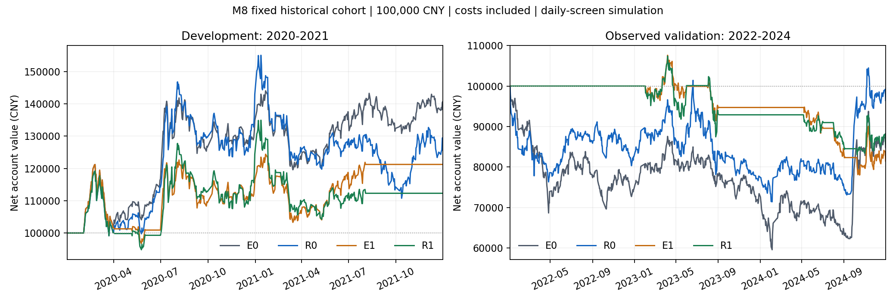

# M8投资研究结果：有持仓对照，排序增量尚不确定

**32/32路径完成，0失败、0未运行。结论为INCONCLUSIVE；建议停止并归档本配置，不据此继续参数或产品搜索，也不升级部署。** 验证期排序相对同池等权的成本后点估计为正，但开发期方向相反、区间包含零，而且增量集中于少数产品和月份。这里只评价`R1I_HISTORICAL_LIQUID_V1`有限历史产品组，不外推全部行业ETF。

所有账户本金10万元，均为含费用、整手、T+1、限价、停牌和无法成交约束的日线模拟，非已实现收益。开发2020—2021与已观察验证2022—2024各自现金起步，未拼接替代主判断。账户执行代码提交为`3f86333db8e3b4f9ac46e8c696bfa4bb18ee7b3f`。

## 产品组与识别机会

按冻结的历史公告抽样框、2019年末60日成交额中位数、2000万元门槛和精确经济指数去重，17个合格候选形成15个指数代表，取前十：

|产品|2019年目标含义|
|---|---|
|512880|证券公司|
|515000|科技龙头|
|512760|半导体行业；2020名称变更有同一指数原件依据|
|515880|通信设备|
|512800|银行|
|512710|军工龙头|
|512660|军工|
|159939|全指信息技术|
|512720|计算机|
|512290|生物医药|

五个科技相关产品、两个军工产品以及金融与医药并不构成十个独立一级行业。去重解决同一经济指数重复产品，不能消除不同指数的主题重叠；没有用今天成分回填2019暴露。

形成于2019末，最早2020-01-02 21:00可得，首合法锚点2020-01-23、基础执行2020-02-04。形成60日龄与交易252日龄分开。60个安排中1个为组别可得前现金，其余59个均N≥4；排序与等权目标不同月份为开发23/24、验证36/36，实际持仓不同日分别469、725。因此本轮有真实选择机会，不能再用M7的全现金解释；59个月也不是59个独立统计样本。

## 基础账户：绝对收益和相对增量分开

|时期|E0等权|R0动量Top3|E1等权＋趋势|R1动量＋趋势|
|---|---:|---:|---:|---:|
|2020—2021累计净收益|40.76%|29.41%|21.25%|12.31%|
|2022—2024累计净收益|−15.20%|−3.58%|−18.52%|−14.29%|
|开发最大回撤|−16.99%|−28.57%|−20.17%|−22.76%|
|验证最大回撤|−40.41%|−29.56%|−27.48%|−22.65%|
|验证平均现金占比|1.22%|8.31%|70.51%|73.56%|

验证R0累计收益高于E0 **11.62个百分点**，仍亏损3.58%；开发R0低于E0 **11.34个百分点**。主要预登记统计量是完整726日的配对净日收益差，不是以上累计收益百分点差：

- 验证均值 **+1.6474bp/日**；60日主块bootstrap-t/HAC的95%边际区间为 **[−2.8944，+6.5383]bp/日**。
- 20/120日块敏感性区间也包含零，未挑最有利块长；开发均值 **−1.4094bp/日**。
- 验证点估计对应相对E0的年度增量固定费用算术余量 **4,151.41元/年**；开发为 **−3,551.68元/年**。这不是可兑现利润、已知费用或经济确认。实际年度增量固定费仍`null`，经济状态`BLOCKED_HURDLE`，p值没有伪填为零费用检验。

## 趋势改变了什么

趋势是月末共同HS300全收益200日均线开关，不是逐ETF每日跌破均线止损。2022年全部12次安排为OFF，两条趋势规则全年现金；验证期仅11/36次安排为ON。它降低了验证期回撤，却也降低了最终收益：E1比E0少3.32个百分点，R1比R0少10.71个百分点。开发期也没有稳定改进：E1的回撤反而比E0更深。

现有日志的一个例子：2024-08-30锚点为OFF、9/3执行；9/30转ON，10/8决策、10/9才执行。月末与信息延迟会错过月内上涨并承担之后的回撤，不能把公告或政策解释写成已实现新闻择时。记录见各账户`decisions.json`与`orders/fills/rejected_orders.json`；本轮没有新增说明用收益回测。

八条基础账户的最大回撤均超过8%预警及12% paper暂停新增风险治理阈值。本轮没有把这些阈值偷偷变成历史止损；这些结果也不满足据此开放paper/live的风险依据。R0/R1存在价格漂移后的被动单ETF超35%日，原账保留并报警；全32路径没有总名义权重超100%或负现金。实际1%容量上限未截断本组交易，不代表能在开盘盘口成交。

## 固定压力与集中度

|R0−E0净日收益均值|base|费用/滑点2倍|3倍|额外延迟1交易日|
|---|---:|---:|---:|---:|
|开发，bp/日|−1.4094|−1.4051|−1.7018|−1.4140|
|验证，bp/日|+1.6474|+1.5756|+0.4551|+1.7646|

方向未在这四个预登记情景中翻转，但3倍成本使验证点估计缩减约72%。延迟显著改变绝对收益：验证R0从base的−3.58%变为+2.70%，不能拿后者替代主路径。成本改变整手、现金和实际持仓，因此账户收益不保证单调；最小价格单位也使实际滑点金额不按参数倍数线性变化。保留全部非单调结果，未为改善收益修改参数。

验证排序的正向产品配对贡献中，生物医药512290、军工512660、通信设备515880合计约 **81.93%**。2024年1月的配对日收益差之和约0.11445，接近全验证期带符号总和0.11960的 **95.7%**；它约占所有正贡献月份总和的22.7%，两种分母不能混用。少数贡献与其他月份抵消使结论脆弱。

`paired_product_contributions.csv`按各自前日NAV归一化，逐日相加等于R0−E0；另列绝对现金PnL差，二者不混为一个数。正相对贡献可能同时来自增持盈利或少持下跌产品；本组512290/512660中，R0累计产品PnL为正、E0为负，全部正负产品与零年份均保留。

|年度净收益|E0|R0|E1|R1|
|---|---:|---:|---:|---:|
|2020|34.83%|42.98%|16.48%|24.42%|
|2021|4.40%|−9.49%|4.10%|−9.73%|
|2022|−25.43%|−17.43%|0.00%|0.00%|
|2023|−1.52%|−5.87%|−5.29%|−7.10%|
|2024|15.46%|24.06%|−13.97%|−7.74%|

## 账户、证据与后续取舍

共19,392账户日、4,646订单记录、4,116成交；80账户年和800产品年全部对账，最大日归因误差5.83e−11元。非作者逐日Decimal账本、全部竞争者信号、40配对均值及主比较6个固定区间独立复算通过，未从实际NAV反推预期。所有路径、配置/版本/表哈希见ACCOUNT_PATHS，完整账簿在`accounts/`；独立审查和验证范围分别说明原件与CI限制。

保留本配置及负面结果作为研究档案。当前证据不足以批准继续搜索或部署；后续若重新研究，需新的独立问题和事前登记，不自动改产品、年份、K、流动性或窗口。原动态R1I仍DATA_BLOCKED，M7 LIMITED_IDENTIFICATION与R1B448有效/353失效中止档案冻结；R2/R3真实Alpha、最终留出、paper/live、采购及股票旁线均未开放。
