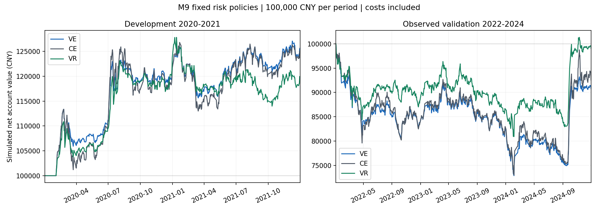

# M9投资研究结果：降波动可见，动态政策增量仍未确认

**24/24条预登记真实历史输入模拟账户完成，0失败、0未运行。主结论INCONCLUSIVE，固定符号检查通过；停止并归档本轮风险策略实验。** VE相对启动固定仓位CE的效用评分点估计在两期及全部固定压力路径为正，但主区间跨零。验证期VE承担更少波动和更高现金，却付出了净收益代价，最大回撤没有改善。不能把这些结果称为纯动态择时Alpha或已验证的部署优势。

## 动态政策付出了什么

CE由首合法开发锚点2020-01-23的未缩放E0篮子确定：60个完整同步收益日，预测年化波动15.8855%，固定c=**0.6295030564604313**；2020-02-03 21:00可得，首次base执行2月4日。所有开发/验证与成本/延迟路径使用同一c，不按后续收益或首次成交重定。VE每月按自身未缩放E0篮子更新alpha，VR按R0篮子计算自己的alpha。十只、资格、动量、月末时钟、费用和原执行模型均与M8一致；账户各从10万元现金起步。

|基础账户|开发VE|开发CE|开发VR|验证VE|验证CE|验证VR|
|---|---:|---:|---:|---:|---:|---:|
|累计净收益|25.67%|25.10%|19.94%|−9.23%|−7.46%|−0.95%|
|CAGR|12.11%|11.86%|9.53%|−3.18%|−2.56%|−0.32%|
|年化实现波动|10.89%|14.48%|10.58%|11.69%|14.55%|11.01%|
|最大回撤|−8.16%|−10.90%|−10.83%|−27.11%|−26.99%|−19.08%|
|平均现金|56.65%|39.81%|64.98%|51.27%|38.29%|55.25%|
|佣金等交易费，元|800.00|800.00|410.88|1590.00|1405.00|655.69|
|嵌入成交价的滑点，元|241.70|239.70|495.30|326.90|212.60|1127.30|

上述是含交易成本的历史日线模拟，不是私人实盘利润。滑点已经进入成交价，不能再从NAV重复扣除。验证VE相对CE累计少 **1.77个百分点**，多付交易费185元及模型滑点114.30元；净日收益差为 **−0.4134bp/日**，95%主区间[−1.9507,+0.6773]bp/日。开发累计多0.57个百分点，但算术净日收益差仍为−0.0876bp/日；累计复利与算术日均是不同统计量，方向可以不同。

## 主问题：评分改善不是收益增量

固定u(r)=r−2.5r²，主端点是u(VE净日收益)−u(CE净日收益)，不是u(VE−CE)，gamma=5仅为研究假设。完整同日现金期都保留。

|主评分差|日均评分差|60日主块95%区间|
|---|---:|---:|
|开发2020—2021|+0.0000814225|[−0.0001226425,+0.0003382847]|
|已观察验证2022—2024|+0.0000330792|[−0.0000934824,+0.0001522180]|

两期20/120块区间也包含零，完整12个预登记评分/净收益区间均在[UTILITY_EVALUATION](UTILITY_EVALUATION.json)。验证主点估计的构成为净日收益差−0.0000413444，加上二次惩罚下降带来的评分项+0.0000744236；它表达了此gamma下收益与风险的取舍，不能换算为Alpha、现金利润或可承担固定费用。

验证VE、CE、VR自身平均日效用分别约 **−0.000242、−0.000275、−0.000109**，均低于零收益现金的u=0背景。正VE−CE不代表正绝对效用、优于现金或正复利。未知年度增量固定费用仍null，经济确认仍BLOCKED_HURDLE；这里没有给效用分数套货币门槛。

## 风险下降与更多现金不能分开冒认

VE月度非空alpha均值为开发45.56%、验证50.07%，均低于固定c的62.95%。实际平均现金分别比CE多16.83、12.98个百分点。开发alpha范围26.81%—71.64%，验证23.32%—75.11%；VE/VR均未触及alpha=1。CE是启动固定政策，**并非全期精确风险匹配对照**；VE−CE同时包含平均风险水平和动态调整差异，本实验不能将降风险全部归为纯动态择时技巧，也没有事后另加50%对照。

验证最差5%日收益的经验均值：VE −1.4854%、CE −1.7992%；每期尾部数量固定为ceil(5%×完整账户日数)，开发25日、验证37日。尾部波动改善没有带来验证最大回撤改善：VE反而比CE深约0.13个百分点。全部验证基础账户仍超过12%治理门槛，不能据此开放paper/live。

以完整60个账户净收益滚动计算，VE实现波动严格超过10%的窗口比例为开发 **45.67%**、验证 **50.52%**；CE为89.93%、90.25%，VR为40.28%、34.03%。预测风险来自当前未缩放篮子的过去窗口，实际风险还受下一阶段价格、组合变化、月度执行和费用影响。公式内缩放到10%不是实现风险或最大回撤保证。全部分布、超标日数和逐年风险见[账户指标](account_metrics.csv)、[rolling60](realized_rolling60_risk.csv)、[月度风险与目标](RISK_SIGNALS.json)。

## 跨期、压力与集中度

下表单位为“每日效用评分差×10⁻⁵”，**不是收益bp**：

|VE−CE|base|2倍费用/滑点|3倍费用/滑点|额外延迟1交易日|
|---|---:|---:|---:|---:|
|开发|8.142|8.229|8.303|6.582|
|验证|3.308|3.496|2.538|3.019|

开发base及验证三条压力的点估计全部>0，按事前规则标ROBUSTNESS_SIGN_CHECK_PASSED；它是符号条件，**不改变主CI跨零的INCONCLUSIVE**。净日收益差在八个情景中均为负。没有对压力另开显著性检验网格。

|年度累计净收益|VE|CE|VR|
|---|---:|---:|---:|
|2020|21.93%|21.65%|23.78%|
|2021|3.06%|2.84%|−3.10%|
|2022|−16.11%|−16.22%|−11.54%|
|2023|−1.45%|−0.94%|−2.05%|
|2024|9.78%|11.49%|14.31%|

年度VE−CE平均评分在2023为负，其余四年为正。验证36个月中23个月评分贡献正，前三个正贡献月占全部正贡献约42.46%；2022年4月的评分贡献和0.024442，略大于整段净和0.024016，反映其他月份正负抵消，不能说全部收益都来自该月。开发前三个正贡献月占全部正贡献66.79%。2024年1月保留，其本轮评分贡献为 **−0.003092**，没有因不利而删除。

年度×产品含费用PnL精确到账户；验证VE−CE净日收益贡献只有生物医药512290汇总为正，其余九只为负。产品表分开保存按各自前日NAV归一化的收益贡献与现金PnL差。二次效用含交叉项，**不将产品净收益贡献冒充可加的产品效用贡献**。见[年度产品](annual_product_pnl.csv)、[配对产品](paired_product_contributions.csv)、[全部月份](paired_month_contributions.csv)。

执行差异有真实账据：2022-01-05验证VE/CE的2倍成本路径拒绝515000买单，3倍另拒绝512290，原因是滑点后价格超出合法日价格区间；不是“费用更高提高收益”。开发VE/VR的3倍路径在2020-04-02首次持仓分叉也包含滑点后的卖单拒绝。更高成本通过最低费、报价单位、合法价格、整手和现金改变实际持仓，结果无需单调。18条最早分叉的有限核验见[执行差异复核说明](../m9_review/EXECUTION_DIVERGENCE_REVIEW.json)，其作者身份与独立全账簿复核分列；完整单笔详情留本地，不新增诊断回测。

## VR与M8背景、保留和归档

VR验证累计−0.95%、波动11.01%、回撤19.08%，比VE的对应结果好；开发VR累计19.94%，低于VE25.67%，2021也为负。验证延迟路径VR累计转正2.46%，平均效用仍负，不能把这个最有利辅助路径换成主结果。VR说明同一风险方法能接入排序篮子，只给兼容和风险描述信息，不重新认证M8动量Alpha。

M8原账户只引用，不重跑：其验证E0累计−15.20%、波动23.14%、回撤40.41%；共同趋势E1累计−18.52%、回撤27.48%，约70.5%现金。M9风险政策使用同一数据/费用/主引擎，新增的是已登记的风险目标。M9与旧趋势背景不能替代VE−CE主对照，开发和验证始终分开。

**保留**直接篮子风险估计、经济暴露拆分不变性、固定初始化、时钟/账户和独立审查组件；保留CE作为可执行研究基准，均非部署推荐。**归档并停止**把当前VE动态政策视为已经确认优于固定政策的策略假设，以及本轮VR兼容收益实验；M8动量/共同趋势继续归档。无需据本结果自动改波动目标、窗口、gamma、名单或频率，后续独立确认/股票数据路线另需集中研究决策。

## 账户与复现

24路径共14,544账户日、4,453成交，60账户年及600年度产品行保留；最大日归因误差4.37×10⁻¹¹元。独立Decimal重建最大NAV差9.03×10⁻¹¹元，12个预登记区间、720个目标、1,000个产品汇总及480个月份配对通过。[ACCOUNT_PATHS](ACCOUNT_PATHS.json)绑定公开NAV/配置/风险/源hash和本地完整账；[独立审查](../m9_review/INDEPENDENT_REVIEW.md)明确原件范围。

登记提交`a696c13dc2f6bf7aba4820fc1ee16ed55dd19ad5`，全部账户执行提交`a2fbb04e76c6e80c262eb86ab621e2dc49f29635`，实际源码hash `dc4e7a79f6f5373d5af15d71def409d54e7209d3ae927c818c72d31d5a96e6a3`。代码已恢复到可检出的src/scripts/tests，公开CI真实执行M8/M9。原市场请求0、旧结果不变、股票/最终留出/paper/live关闭。最终远端提交、测试、预算与命令见[集中审查](../m9_review/REVIEW_PACKET.md)。
